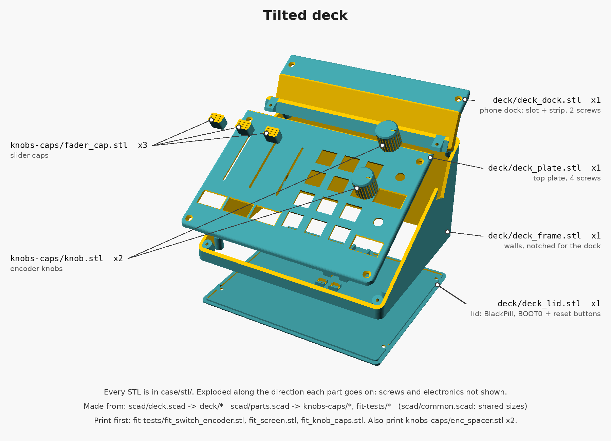
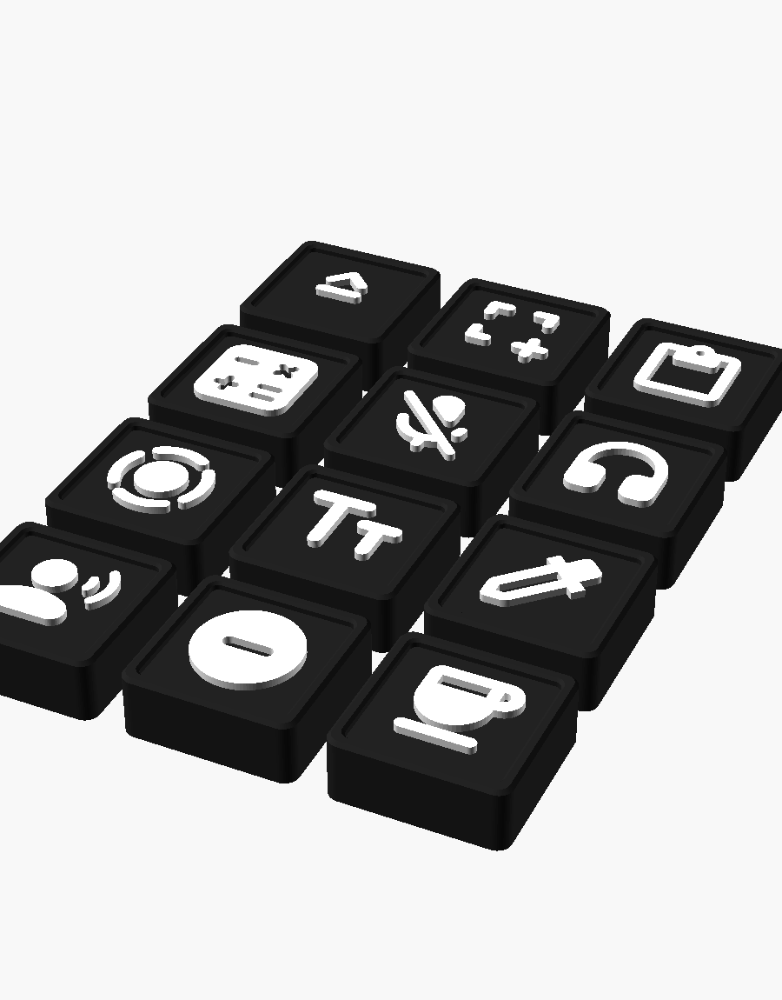
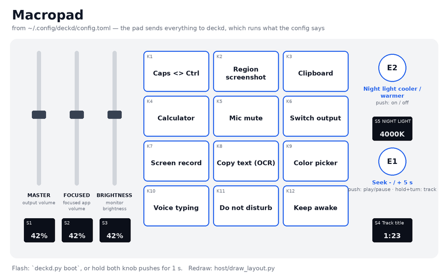

# Handwired macropad (tilted deck)

12 MX keys, 2 EC11 encoders, 3 slide pots and 5 small OLED screens on a 30 degree wedge with a phone slot across the back. Handwired; an optional plate PCB that replaces the plate wiring is in `pcb/`. Runs on an STM32F411 "BlackPill" with QMK, USB-C only, no battery.

Everything lives in [`macropad/`](macropad/); file paths below are relative to it.

```
 +---------------------------------------------+
 | ========== phone slot (recessed) ========== |   back, 100 mm tall
 |                                             |
 |  ||   ||   ||   [K1]  [K2]  [K3]           |
 |  ||   ||   ||   [K4]  [K5]  [K6]    (E2)   |
 |  ||   ||   ||   [K7]  [K8]  [K9]    [S5]   |
 |  ||   ||   ||   [K10] [K11] [K12]   (E1)   |
 | [S1] [S2] [S3]                      [S4]   |   front, 13 mm tall
 +---------------------------------------------+
                  177 x 150 mm
```

Keys on a 21 mm grid (about 3 mm between caps), centred between the slider screens and the knob column, 5 mm margins each side; E2 is level with the top key row and E1 sits just behind S4. Each screen sits in front of its slider or knob. Every outside edge is rounded (2.5 mm, vertical corners 6 mm).

```
```

Beginner step-by-step guide with illustrations: `build-guide.pdf` (exported from the live doc at https://claude.ai/code/artifact/070e5841-1c04-4409-ae30-39a42349cde0; re-export after editing it).

Plate PCB (optional, replaces step 4 of the assembly and the plate end of the wiring; lid unchanged): `pcb/README.md`.

Full wiring diagram: `wiring/wiring.html` (regenerate with `wiring/build.py`), published at https://claude.ai/artifact/4pcYRyfMjdKxRtB2dDA4gZ. One drawing, to scale, shows the case opened up for wiring: lid (BlackPill, multiplexer, buttons) on top, turned round, plate underside below, their back edges at the fold. Bare copper buses are thick lines, insulated wires thin. The 27 wires between plate and lid are soldered at the plate end, gather along its back edge into five flat ribbons, and end in five multi-pin Dupont plugs on header pins, so the lid unplugs; each wire's number is on its line and in the harness table. Click a part, bus or number to see only its wires.

Firmware: QMK for the BlackPill in `firmware/deck` (keymaps `default` and `test`, layout and daemon below). The pin map below is final. Screens: Quantum Painter's `sh1106_i2c` driver (it covers the SSD1306), 128x64 at 0x3C, on I2C1 (B6 / B7, 400 kHz); before drawing to a screen, write `1 << channel` to the TCA9548A at 0x70.

## Parts

| Part | Qty | Notes |
|---|---|---|
| STM32F411CEU6 "BlackPill" (WeAct or clone) | 1 | chip must read STM32F411CEU6, crystal 25.000 |
| MX switches | 12 | |
| EC11 encoder, 5 pin (with push) | 2 | have |
| Bourns PTA4543-2015DPB103 slide pot (45 mm, 10k linear) | 3 | caps printed: `case/stl/knobs-caps/fader_cap.stl` |
| 0.96" OLED 128x64 SSD1306, 4-pin I2C | 5 | have; SDA SCL GND VCC from the back, all at address 0x3C |
| TCA9548A I2C multiplexer breakout | 1 | one channel per screen, since they all share one address; hot-glued in the lid |
| 1N4148 diode, through-hole | 14 | 12 keys + 2 encoder pushes |
| 100 nF ceramic capacitor | 3 | one per slider, beside its body: pin 2 to the GND back bus |
| 6x6 mm tactile switch, 5 mm tall | 2 | have; B (BOOT0) and R (reset) in the lid |
| Solid-core wire 24-26 AWG | 2 colours | rows / columns |
| Silicone wire 28-30 AWG | several colours | jumpers on the plate; use the wiring page's colours |
| Rainbow ribbon cable, 1.27 mm pitch | ~1 m | the 27 plate-to-lid wires, as five ribbons |
| Male header strip, 2.54 mm | 2 x 20 + mux | soldered on the BlackPill and multiplexer, long pins up |
| Dupont housings + female crimps | 1x10 x2, 1x5, 1x3, 1x1 | plugs A-E (below); or F-F jumpers cut and soldered |
| M3 x 8 flat-head (countersunk) screw | 10 | 4 plate (2 into the frame, 2 into the dock), 2 dock strip, 4 lid; they cut their own thread in the printed holes, no inserts. M3 x 10 grips better |
| Hot glue | | slide pots and screens sit on printed pegs under the plate; BlackPill and buttons in the lid |
| Rubber feet | 4 | |
| Keycaps 1u | 12 | printed: `case/stl/keycaps/` (flat, black, pressed-in labels) |
| ST-Link V2 (optional) | 1 | rescue flashing over SWD if USB DFU fails |

## Matrix and pins

4 rows x 4 columns, `col2row`: diode anode on the switch, **black band toward the row wire**. Column 3 holds only the two encoder pushes, each on the row nearest it; the push pin nearer the keys takes the diode.

```
          col0 (A7)   col1 (A8)   col2 (A15)  col3 (B0)
row0 A4     K1          K2          K3          E2 push
row1 A5     K4          K5          K6          -
row2 A6     K7          K8          K9          E1 push
row3 B14    K10         K11         K12         -
```

| Signal | BlackPill pin |
|---|---|
| Encoder 1 A / B | B1 / B8 |
| Encoder 2 A / B | B9 / A0 |
| Encoder C (middle of the 3 pins, both) | G |
| Slide pot pin 2 (wiper), sliders 1 / 2 / 3 | A1 / A2 / A3 (ADC1_IN1-3) |
| Slide pot pin 1 (all three) | 3V3 |
| Slide pot pin 3 (all three, alone at the front end) | G, by a short jumper to its own screen's GND pin; 100 nF beside the slider (right of it, from the back), pin 2 to the GND back bus |
| Screens GND / VCC (all five) | G / 3V3 |
| Multiplexer SCL / SDA (I2C1) | B6 / B7 |
| Multiplexer VIN / GND | 3V3 / G |
| Screen SDA / SCL, S1 S2 S3 S4 (E1) S5 (E2) | mux channels 0 1 2 3 4 (SDn / SCn) |
| R button | R (NRST) and G |
| B button | across the board's own BOOT0 button (BOOT0 has no pin hole) |

Avoid: A9 (USB VBUS sense, internal pull-down), A10 (can stop DFU), A11 / A12 (USB), B2 (BOOT1), C13 (LED), C14 / C15 (32 kHz crystal). B14 is row 3. Free: B3, B4, B5, B10, B12, B13, B15. A0 shares the board's KEY button, which is fine for an encoder input. A4-A7 also go to the optional SPI flash footprint on the back: fine as long as no flash chip is fitted. Pin caveats from the [QMK BlackPill notes](https://docs.qmk.fm/platformdev_blackpill_f4x1).

**Plugs on the header pins** (mark pin 1 of each plug and its header):

| Plug | Pins | Wires |
|---|---|---|
| A, 1x10 | BlackPill A0 A1 A2 A3 A4 A5 A6 A7 B0 B1 | 14 15 16 17 1 2 3 5 8 11 |
| B, 1x10 | mux SD0 SC0 SD1 SC1 ... SD4 SC4 | 18-27 |
| C, 1x5 | B8 B9 (5V empty) G 3V3 | 12 13 9 10 |
| D, 1x3 | B14 (B15 empty) A8 | 4 6 |
| E, 1x1 | A15 | 7 |

The lid's own wires: mux SCL / SDA to B6 / B7, mux GND / VIN to G / 3V3 on the other header, and the two buttons.

**Wiring happens upside down, so everything is mirrored.** From below, K1 is at the top right, the sliders are on the right and the knob column is at the left.

## Flashing

- USB DFU: hold B, tap R, let go of B; the board shows up as `STM Device in DFU Mode` (`lsusb`). Flash with `dfu-util` / `qmk flash`. If it won't enter DFU, retry, or add a 22k pull-up on A10.
- A `QK_BOOT` key in the keymap covers day-to-day flashing.
- Rescue: ST-Link V2 on the 4-pin SWD header (3V3 sense, DIO = PA13, SCK = PA14, G), board powered over USB. `st-info --probe` should report chip id `0x431`; `st-flash write firmware.bin 0x08000000`.

## Case (case/)

Rebuild every STL and preview with `case/build.sh` (OpenSCAD 2021.01).

```
case/
  build.sh        all STLs + previews
  diagram.py      preview/assembly.png (run by build.sh)
  scad/
    common.scad   shared sizes: key grid, switch/encoder holes, screws, screen module, lid
    deck.scad     the deck: plate, phone dock, frame, lid
    parts.scad    encoder knobs and spacers, slider caps, fit tests
    keycaps.scad  flat keycaps and their pressed-in labels
    fonts/        DeckIcons.ttf: Material Symbols Rounded, filled, weight 600, for the label icons
    exploded.scad exploded view for the diagram (not a print)
  stl/
    fit-tests/    print these first
    deck/         plate, frame, lid
    knobs-caps/   knobs, encoder spacers, slider caps
    keycaps/      keycap, label set (body + legend), blank label
  3mf/            ready-to-print Bambu Studio projects for the keycaps (make_3mf.py)
  stickers/       the key icons as A4 sticker sheets, white paper and clear film (make_stickers.py);
                  text legends for DSA caps, yellow and black, 11 mm (make_text_stickers.py)
  preview/        renders; assembly.png shows which STL goes where
```



**What to print**

| STL | Qty | Notes |
|---|---|---|
| `fit-tests/fit_switch_encoder.stl` | 1 | One switch cutout and one encoder hole. **Print first.** Switches should click in firmly; the encoder bushing should pass through. Tune `switch_cut`, `enc_hole` in `common.scad` (`enc_hole` is 7.8: 7.3 printed too small for the thread). |
| `fit-tests/fit_screen.stl` | 1 | One screen pocket and window. Printed top face down; the arrow points at the header end. The module's glass should drop into the pocket, the lit area fill the window, the 4 pegs go through the mounting holes. Tune the `scr_*` sizes in `common.scad`; they are typical values, not measured. |
| `fit-tests/fit_knob_caps.stl` | 1 | 3 knobs with bores 6.30 / 6.34 / 6.38 mm (1-3 dots on top; 6.26 was tight, 6.46 very loose) and 4 slider caps with slots 4.0 x 1.0 to 4.3 x 1.3 mm (1-4 notches). Keep what grips, set `shaft_bore` / `lever_tol` in `parts.scad`. |
| `fit-tests/fit_knob.stl` | 1 | 3 short hubs (top 8 mm of the knob's bore) with bores 6.30 / 6.34 / 6.38 mm, 1-3 dots in the roof; quick to print. Keep the one that grips, set `shaft_bore` / `d_flat` in `parts.scad`. |
| `fit-tests/fit_keycap_caps.stl` | 1 | 3 keycaps with the MX cross at 4.0 x 1.2 / 4.1 x 1.3 / 4.2 x 1.4 mm (1-3 dots in the skirt's front edge). Black only, upright, no supports. Keep the one that pushes onto a switch firmly; set `cross` in `keycaps.scad`. |
| `fit-tests/fit_keycap_labels.stl` + `fit_keycap_legend.stl` | 1 | AMS test, one colour swap: load both as one object, black + white. 3 labels with 0.00 / 0.05 / 0.10 mm clearance each side (1-3 dots underneath), carrying the calculator (finest detail), region screenshot (thin strokes) and do-not-disturb (big white area) icons. Keep the one that presses into a test cap firmly and stays when the cap is shaken; set `label_tol`. |
| `fit-tests/fit_bp_cradle.stl` | 1 | 4 copies of the two ends of the lid's BlackPill cradle (front wall, rail ends; tied by thin bars), raised +0.4 / +0.8 / +1.2 / +1.6 mm (number on the base), each with a slice of the frame's back wall and its USB-C hole. Drop the board in upside down and plug a cable in: keep the one where the plug goes in straight and the board stays put, set `bp_raise` in `deck.scad` to its number, then rebuild and print `deck_lid`. |
| `deck/deck_plate.stl` | 1 | Sloped top in front of the phone slot, with all cutouts: 3 mm thick, 1.5 mm at every switch, encoder and pot, 0.8 mm over each screen, glue pegs underneath. 4 screws: 2 front corners into the frame, 2 back corners into the dock. Printed flat, top face down. |
| `deck/deck_dock.stl` | 1 | The phone dock: slot walls and floor, the strip of top behind the slot, and two screw blocks under the plate's back corners. Slides into notches in the frame's side walls; 2 screws through the strip into the frame. Printed standing on the slot floor, no supports. |
| `deck/deck_frame.stl` | 1 | Walls of the wedge, printed upright, notched in both side walls for the dock. USB-C in the back wall. |
| `deck/deck_lid.stl` | 1 | Flat bottom with the BlackPill cradle and pockets for the BOOT0 and reset buttons (marked B and R underneath). The BlackPill goes in upside down (chips, buttons and USB-C facing the lid, long header pins up), resting its pin stubs on two rails; set `bp_usb_h` and `bp_stub_h` in `deck.scad` from calipers. |
| `knobs-caps/knob.stl` | 2 | Encoder knob, 17 mm across, 17.5 mm tall: covers the uncut 20 mm shaft under a 0.8 mm roof, reaching 2 mm further down the shaft (`knob_skirt`). Plain D bore copied from a Stream Deck+ knob that fits these shafts (6.16 mm, 4.59 mm across the flat). Recess underneath clears the bushing. Upside down, no supports. |
| `knobs-caps/enc_spacer.stl` | 2 | 3 mm spacer ring on the encoder bushing under the plate, so the encoder and its shaft sit 3 mm lower. About 2.5 mm of thread is left above the plate: enough for the nut without its washer if your thread reaches; otherwise hot-glue the spacer to the plate and the encoder to the spacer. Thickness is `enc_spacer` in `common.scad`; the knob gets shorter to match (0 = no spacer). |
| `knobs-caps/fader_cap.stl` | 3 | Cap for the Bourns PTA slide-pot lever (4 x 1 mm metal blade). Upside down. |
| `keycaps/keycap.stl` | 12 | Flat blank MX cap, 18 x 18 x 6.8 mm, black. Printed upright (skirt and stem post on the bed), no supports: the only bridge is the cavity ceiling, at most ~5 mm from skirt to post. A 15.2 mm square pocket, 1.8 mm deep, in the top takes a pressed-in label flush with the top; an eject hole in the pocket floor beside the post. |
| `keycaps/label_body.stl` + `keycaps/label_legend.stl` | 1 set | The 12 labels (icons from `~/.config/deckd/config.toml`), face up, laid out as on the pad. Load both STLs as **one object with two parts** (Bambu Studio / Orca: import both, answer yes to "load as a single object with multiple parts"), body black, legend white. The black body is the bottom 1.0 mm and the white legend the top 0.8 mm (4 layers at 0.2) standing on it, so the AMS swaps colour once. No supports. The legend is flush with the cap top; the black around it sits 0.8 mm lower. |
| `keycaps/label_blank.stl` | spare | One plain black label, full height. Single colour: print it with the caps, not with the label set (it would add a swap every layer). |

**Settings**

- `common.scad`: `switch_cut`, `enc_hole`, `enc_spacer`, `enc_bush_l`, `clip_t`, screw sizes and `pilot_d` (the hole M3 screws thread into), glue peg size `peg_d`, screen module sizes (`scr_*`), `usb_cut`, `tol`.
- `deck.scad`: `tilt` (the Foxwood stand is 24.8), `front_h`, `block_b` (sliders along the slope), `key_block_b` (keys), `side_m` (side margins), edge rounding (`corner_r`, `edge_r`, `lip_r_front`, `lip_r_back`, `slot_chamfer`), `key_pitch` (21), `pot_pitch` (26, a screen module plus a gap), `scr_b` (front screen row), `enc_gap` (knob to the screen in front of it), dock screw blocks (`dock_ledge`, `dock_ledge_d`, `dock_pilot`), `pad_w` (plate width, fixed at 177.2), BlackPill size and `bp_usb_z`, pot sizes and `pot_peg_d`, phone slot (`phone_t`, `phone_angle`, `phone_b`, `phone_depth`).
- `keycaps.scad`: `cross` (MX socket), `label_tol` (label in its pocket), `cap`, `cap_h`, `label_t`, `legend_d`, `rim`, `icon_size`, and `legends`: one entry per key, an icon (a Material Symbols codepoint as `"\uXXXX"`; look names up at fonts.google.com/icons) or 2-4 characters of text. Rebuild with `case/build.sh`.
- `parts.scad`: `enc_shaft_l` (15 or 20, measure from the bushing base), `knob_gap`, `knob_roof`, `enc_shaft` (`"D"` or `"round"`), `shaft_bore`, `d_flat`, `knob_d`, `lever`, `lever_tol`, `fader`.

**Keycaps.** Flat, blank, black, with a pressed-in label. Caps and labels print as separate jobs, none with supports: caps black only, labels with one black-to-white swap. Put the caps on the switches, then press each label in, icon upright as you face the pad. The pocket is square, so the label goes in any way round; friction holds it. To change one, pull the cap and push a paperclip up through the eject hole beside the stem.

**Keycap print files (`case/3mf/`).** Bambu Studio projects for a P1S 0.4 with 0.20mm Standard, Textured PEI plate at 65 / 60 °C, and PLA Basic, filament 1 black and filament 2 white (map them to your AMS slots when sending). Each piece is its own object; each label is one object with a black body part and a white legend part. All four slice with no supports; the label files swap colour once.

| File | What | Swaps |
|---|---|---|
| `fit_keycap_caps.3mf` | 3 fit-test caps | 0 |
| `fit_keycap_labels.3mf` | 3 fit-test labels | 1 |
| `keycaps.3mf` | 12 caps | 0 |
| `labels.3mf` | 12 labels, laid out as on the pad | 1 |
| `labels_blank_white.3mf` | 12 plain labels, filament 2 (white), for the clear stickers | 0 |
| `glue_labels.3mf` | 12 glue-on labels for a bought flat cap (below) | 1 |

`case/make_3mf.py` builds them from the STLs (run by `build.sh`); printer and filament settings come from `case/bambu_p1s_settings.json`, a project config exported by Bambu Studio 2.8 (a single-nozzle printer needs the 2x2 `flush_volumes_matrix`).

**Glue-on labels (bought caps).** For flat MX caps like KeyCap v4 (flat 18.4 mm square top, square edges, corners ~r 1.5): `case/3mf/glue_labels.3mf`, 12 plates 17.8 mm square (0.3 mm of cap left round each), 1.2 mm black base with the white icon standing 0.8 mm on it, icons 13 mm, each with a 3 mm brim (trim it off). Ironing is on for every top surface, so both the black background (at 1.2 mm, before the swap) and the icon tops are ironed; one colour swap, ~33 min. Glue them on with a thin layer of CA gel or contact adhesive, icon upright as you face the pad. Sizes are `glue_*` in `keycaps.scad`; STLs in `case/stl/glue/`.

**Stickers.** `case/stickers/stickers.pdf`: 9 sets of the 12 icons for sticker paper, A4, white icon on a black 14.6 mm square (just under the 15.1 mm label face), laid out like the pad. Only the black is printed; the white is the paper, so any printer works on white sticker paper. The black runs 1 mm past each cut line (thin white hairline), so a slightly-off cut still leaves a black edge on the black cap. Print at 100% / actual size and check the 50 mm bar. Stick them on blank labels (`label_blank.stl`) for a single-colour print, or use them as spares. `case/make_stickers.py` reads the icons from `keycaps.scad`, so the sheet follows any change there.

**Clear sticker film.** `case/stickers/stickers_clear.pdf` (6 sets). Clear film has no white, so the icon is left unprinted and a **white** label shows through it: print `labels_blank_white.3mf` (one colour), stick a sticker on each label with the icon centred, trim it flush with the label's edge with a craft knife (the black runs 1.5 mm past the 15.1 mm label face, no cut line), then press the label into its black cap. Laser prints are the most opaque on film; on inkjet use the transparency/film paper setting and let it dry.



**Phone slot.** The phone (sized for an iPhone 16 Plus in a case, `phone_t` = 11) sinks 15 mm in and leans back at 70 degrees; the slot floor is square to its walls. The slot is open at both side walls, so a phone wider than the deck fits in landscape and can charge from the side; in portrait the charging port is below the slot floor.

**Screens.** Each sits under the plate with its glass in a pocket, seen through a bevelled window in the 0.8 mm skin left above it, header toward the back. The window stops `scr_win_inset` (1 mm) inside the lit area, leaving a border. Four printed pegs go through the module's mounting holes; a dab of hot glue on each peg tip holds it. Keep glue off the glass. The slide pots are held the same way: 2 pegs into the threaded holes in each body's ends, glued. S4 and S5 sit in the encoder column, each in front of its knob.

## Assembly order

1. Print the fit tests; adjust and rebuild until they fit.
2. Run an M3 screw into each of the 8 posts of the frame and the 2 holes in the dock's screw blocks once and back it out, to cut the thread.
3. Plate, upside down on the table: clip in the switches; encoders with the spacer ring, nut on top (no washer) or hot glue, anti-rotation tab snipped; sliders and screens on their pegs, glued.
4. Wire the plate (`wiring/wiring.html`): lay the copper buses (sleeve every row/column crossing), then diodes, column joints, knob, slider and screen jumpers to the buses.
5. Lid: solder L5's two wires onto the BlackPill's own BOOT0 button first (it ends up underneath). BlackPill upside down in its cradle (chip side down, long pins up, USB-C at the back), multiplexer long pins up, glued right of the BlackPill seen from above (beside B6 / B7); glue them in, wire L1-L6 (mux to BlackPill, buttons). Then the 27 numbered wires: solder each at its plate end, run it along the plate's back edge to its ribbon, and crimp the five ribbons into plugs A-E. Leave ~3 cm of slack at the fold so the case opens like a book; sleeve or lace the ribbons there.
6. Test with a meter, USB unplugged (the checklist at the end of `wiring.html`).
7. Close: slide the dock into the frame and screw its strip down (2 M3 x 8), then the plate (4 M3 x 8: 2 front into the frame, 2 back into the dock), lid from below (4 M3 x 8). Turn each screw backwards until it clicks into its thread before tightening.

## Keys, knobs, sliders (host/)

The `default` keymap only reports: every key, knob push, knob click and slider move goes to `host/deckd.py`, a background daemon (no UI), which runs what `~/.config/deckd/config.toml` says and draws all five screens. Change a key by editing that file and `systemctl --user restart deckd`; no reflashing.



- Keys: one shell command each (`run = "..."`), mostly Omarchy's own scripts.
- E1: seek 5 s a click, hold the push and turn for previous / next track, push alone = play / pause (S4: track title and elapsed time). E2: night light temperature, push = on/off (S5).
- Sliders: S1 output volume, S2 volume of the focused window's app (S2 shows its name), S3 brightness of all monitors over DDC/CI (`ddcutil`, ~0.3 s per change). A slider acts only when moved, not when the pad connects.
- Browsers: Chromium plays every tab through one audio stream, so S2 can't tell browser windows apart from outside. `host/browser/` has a small extension that fixes that: with a browser window focused, S2 sets the volume of the media in that window's active tab (YouTube through its own player, so its slider follows) and S2's screen shows the site. Set up once: `host/browser/install.sh` (registers the native messaging host for Chromium and Chrome), then chrome://extensions, Developer mode, Load unpacked, `host/browser/extension`.
- Without the daemon the keys do nothing and S1-S3 show the raw slider positions.

```bash
host/install.sh                     # systemd user service, config to ~/.config/deckd/config.toml
journalctl --user -u deckd -f       # log, shows each command it runs
systemctl --user restart deckd      # after editing the config
host/draw_layout.py                 # redraw host/layout.png from the config
host/deckd.py boot                  # bootloader, then: qmk flash -kb handwired/deck -km default
```

`firmware/flash.sh [keymap]` does both steps (build, jump, flash) with no hands on the pad. Bootloader without the daemon: hold both knob pushes for three seconds (`deck.c`). Needs `python-hidapi`, `pactl`, `hyprctl`, `ddcutil`.

`helper/` is the older joystick-axis slider helper, superseded by `host/`.
