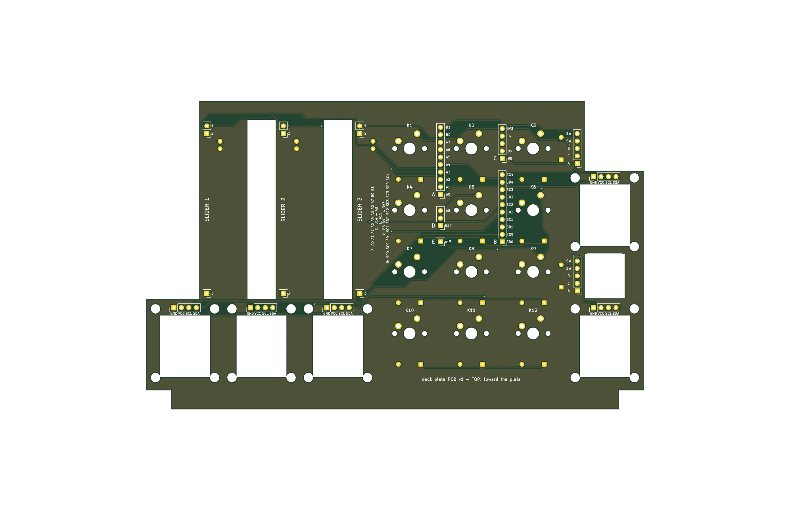
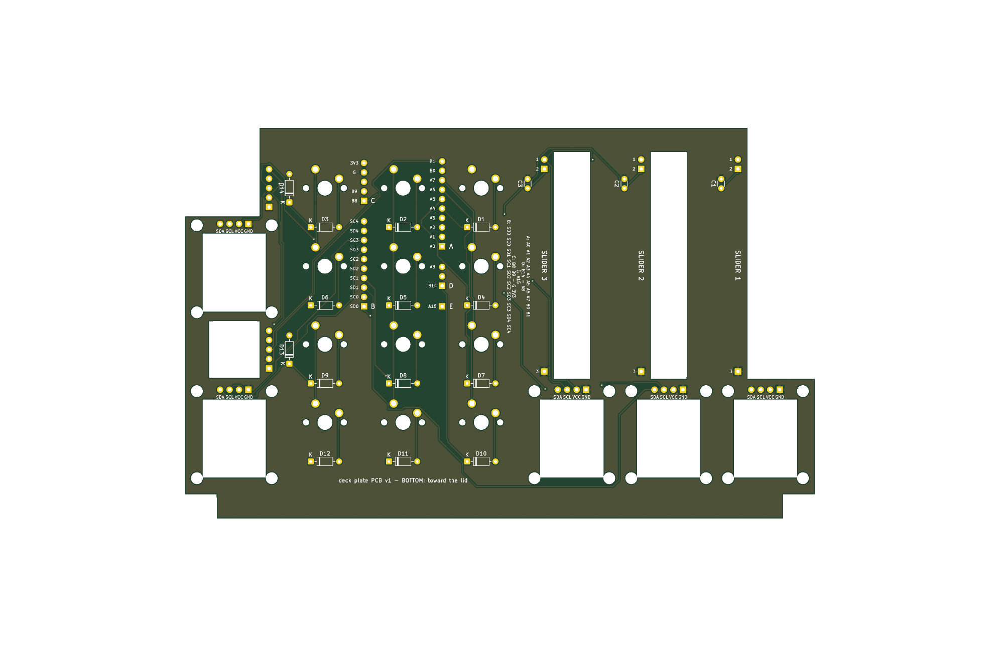

# Plate PCB (v1, not yet ordered)

One 2-layer board under the plate that replaces the plate's handwiring: rows, columns, diodes, power buses and screen jumpers. Fits the printed parts as they are: no plate, frame, dock or lid reprint. Same pins as the handwired build, so the firmware doesn't change.

## How it sits

- Parallel to the plate, its top face 5 mm below the plate's top, the standard MX height. The switches clip into the plate and solder to the board. The board hangs from their pins and the screens' pins; it has no screws.
- **Screens** sit on their glue pegs as before, 0.4 mm above the board. Their 4 header pins go straight through it. Pry the black plastic spacer off each module's pins first (flush cutters under it, lever it down the pins). Pin order on the board, left to right seen from the top: **GND VCC SCL SDA**. Check it against your module's printing before soldering. The pegs pass through 3.2 mm holes.
- A **window under each screen** (17 x 21 mm) clears the parts on the module's back. Check that none of those parts sits outside the window, i.e. within ~2.5 mm of the header row.
- **Slide pots and encoders** are too tall to solder flat (the pots are about 7 mm deep, the encoders 6.5 mm plus the 3 mm spacer). They keep their plate mounts and pass through cutouts. A short wire joins each pin to a labelled pad beside its cutout:
  - pot: pins 1 and 2 at the back end, pads `1` (3V3) and `2` (wiper); pin 3 at the front end, pad `3` (GND). The 100 nF cap is on the board (C1-C3).
  - encoder: column of 5 pads left of the cutout, front to back `A C B SW SW` (A, C, B = the 3-pin side; the two SW pads take the two push pins, either way round). The push diode is on the board (D13, D14).
- **Lid unchanged.** The mux and BlackPill stay where they are, and plugs A-E stay as they are. The 27 ribbon wires solder into the pad groups A-E in the two channels between the key columns, one wire per labelled pad (silk names the BlackPill pin or mux channel). The square pad is each group's first pin. Empty positions (B15 in D, 5V in C) keep the plug spacing, so you can fit male headers and Dupont plugs at this end too.

## Parts on the board

| Ref | Part | Side |
|---|---|---|
| K1-K12 | MX switch (3- or 5-pin) | top, through the plate |
| D1-D14 | 1N4148, through-hole | bottom; band (square pad, `K`) toward the row |
| C1-C3 | 100 nF ceramic, 2.5 mm pitch | bottom |
| S1-S5 | the screens' own pins | top |
| JA-JE | harness wires (or 2.54 male headers) | from the bottom |
| J_P*, J_E* | pot / encoder lead pads | wires from the bottom |

## Build order

1. Solder diodes and caps on the bottom. Trim the leads flush on the top: there is only 2 mm under the plate.
2. Plate upside down: switches clipped in, screens on their pegs (spacers off the pins), pots and encoders mounted as before.
3. Lower the board onto the switch pins, screen pins and pegs together, then solder all of them.
4. Short wires from the pot and encoder pins to their pads.
5. Ribbon wires into JA-JE. Test with a meter, as in `wiring/wiring.html`'s checklist.

## Ordering (JLCPCB)

Upload `deck-gerbers.zip`. It's 169.3 x 105.1 mm, 2 layers, 1.6 mm, HASL, any colour. Over 100 mm, so the $2 price doesn't apply. Rules used: 0.25 mm tracks (a few necked to 0.15 at pads), 0.25 mm clearance, 0.35 mm via drill, GND pour on both layers.

**Before ordering**: print `fit-check-1to1.pdf` at 100 % (no "fit to page"), check a key's 14 mm square measures 14 mm, cut out the outline, and hold it under the plate. Every switch, peg, pot slot and encoder hole should line up.

## Rebuilding

`./route.sh` runs the whole thing: `build_pcb.py` places parts from the deck geometry (mirrors `case/scad/deck.scad`; change sizes there and here together), freerouting autoroutes, then GND pour, DRC (`drc.rpt`, must be clean), Gerbers, renders and the fit-check PDF. Needs KiCad 10 (`pacman -S kicad kicad-library`), Java 25 (`mise install java@temurin-25`) and `freerouting-2.5.0.jar` in `~/.cache/freerouting/` (GitHub releases). `deck.kicad_pcb` opens in KiCad for hand edits, but `route.sh` overwrites it.
